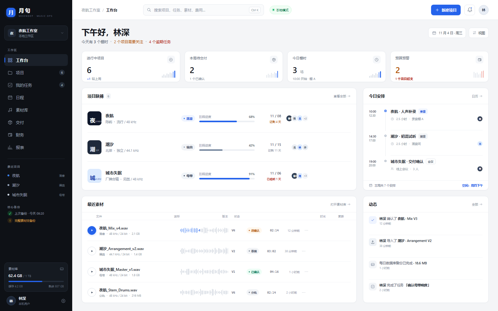
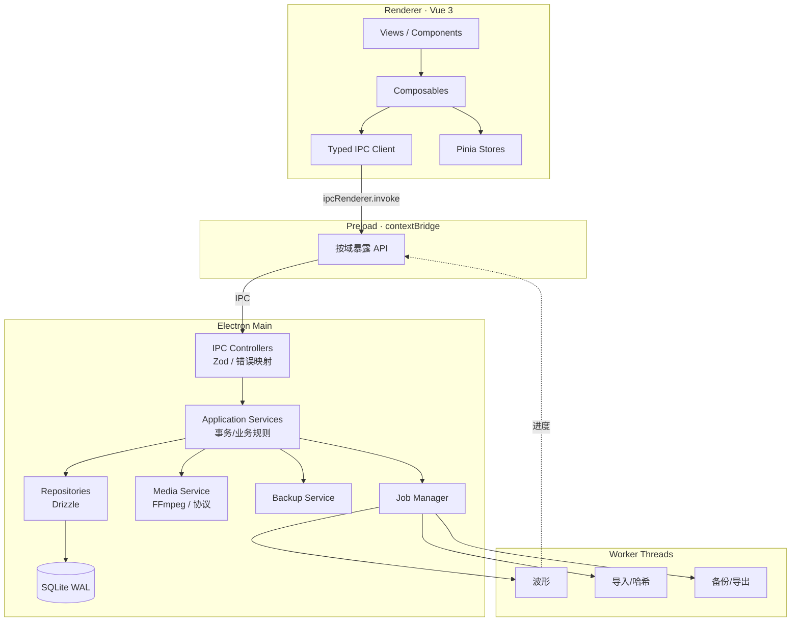
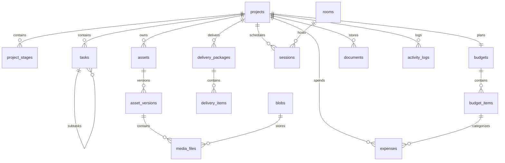

# 月句 MoonDot · 音乐工程项目管理系统开发方案

> **本地单机 · 音频版本可追溯 · 数据自持**
>
> 文档版本：v1.8　|　日期：2026-11-05　|　平台：Windows 10/11 x64、macOS 12+ Apple Silicon
>
> 技术栈：Vue 3 + Vite + Electron + TypeScript + SQLite
>
> 开源协议：MIT　|　版权主体：归尘回梦

---

## 0. 方案摘要

月句（英文名 **MoonDot**）是一套完全本地运行的桌面音乐工程项目管理系统。它不替代 DAW，而是把**项目进度、音频版本、棚时排期、交付链路和项目预算**放进一个可追溯的单机工作空间。

v1.8 将 Windows 发布方案改为 **Microsoft Store + MSIX**：SignPath 申请未获通过，不再作为发布前置条件。保留**阶段进度**、不设日期/周排期和用户自选核心备份目录。Partner Center 尚未配置，执行说明见 [Microsoft Store / MSIX](microsoft-store.md)。

| 确认事项 | 方案响应 |
| --- | --- |
| 核心备份位置由用户决定 | 不硬编码盘符；首次启动/设置中选择目录，校验可写、空间、同盘风险；保存到 `app_settings` |
| 开发方式为阶段进度 | 不设日期/周排期；6 个开发阶段、权重合计 100%、阶段门禁验收 |
| 后续不补 2TB+ 外接盘 | **不提供完整 1TB 素材备份**；只做核心备份 + 同盘快照，风险在发布说明中明示 |
| GitHub 仓库公开 | 公开 MIT 仓库；Windows 由 Microsoft Store 分发与更新；macOS 通过 GitHub Releases 手动更新 |
| Windows 改为 Microsoft Store + MSIX | 商店认证通过后由 Store 重新签名、分发和更新；Partner Center 身份待配置 |
| macOS 暂不配置签名 | 初期 unsigned/ad-hoc 内测；不做公证、不启用自动更新；手动下载 DMG 覆盖安装 |
| 预算多币种/发票号 | 项目基准币种 + 费用原币/汇率/折算金额 + 发票号；离线手动汇率 |
| 不需要应用锁 | 删除应用锁相关规划 |
| 完全本地单机、不做多人协同 | Electron 主进程内嵌后端、本地 SQLite、本地素材库；无账号/权限/云端 |
| 项目使用 MIT | 根目录 `LICENSE`、第三方许可证清单、FFmpeg LGPL 合规 |

> **架构说明**：本方案采用完全本地单机架构，不启动 HTTP 服务、不连接云端、不维护账号体系。
>
> **Vue 3 Renderer → Electron 主进程（内嵌应用服务）→ 本地 SQLite + 本地素材库**
>
> 1TB 素材放在本机磁盘；核心数据备份到用户选择的目录；**不提供完整素材备份**，完整 1TB 灾难恢复不在范围内。

| 关键决策 | 结论 |
| --- | --- |
| 产品形态 | 完全本地单机桌面应用，单用户；不做多人协作 |
| 后端 | Electron 主进程内嵌应用服务；无独立服务器 |
| 数据库 | 本地 SQLite（WAL）；单进程访问 |
| 素材 | 本地 1TB 素材库；SHA-256 内容寻址；核心备份到用户选择目录 + 同盘快照；**不做完整素材备份** |
| 预算 | 多币种 + 发票号；项目基准币种、费用原币/汇率/折算；无审批流 |
| 平台 | Windows 10/11 x64；macOS 12+ Apple Silicon |
| 发布 | Windows MSIX x64 + Microsoft Store 分发/签名/更新；macOS arm64 DMG/ZIP（暂不签名/不公证、GitHub Releases 手动更新） |
| 协议 | MIT（© 2026 归尘回梦）；FFmpeg 等第三方依赖单独遵守其许可证 |
| 推进方式 | 6 个开发阶段、权重合计 100%；按阶段门禁验收；不设日期/周排期 |

**首版成功标准**：完全断网可使用；1TB 素材可导入、检索、播放；所有版本可追溯、可确认；预算（含多币种/发票号）与交付可核对；Windows 稳定版通过 Microsoft Store 认证与分发；macOS Apple Silicon 内测版可手动安装；**核心数据可备份恢复**；源码以 MIT 发布。完整 1TB 素材备份明确不在范围内。

---

## 1. 产品定义

### 1.1 背景

即使只有一个人做音乐，项目信息也容易散落：

1. **项目状态不透明**：不知道一首歌卡在编曲、录音还是混音。
2. **版本混乱**：`final.wav`、`final_2.wav`、`final_真的最终.wav` 并存，缺少时间、备注和确认结论。
3. **任务与素材脱节**：待办在一个工具里，音频在另一个目录里。
4. **排期靠记忆**：棚时、混音、交付节点容易撞车。
5. **交付不可验证**：母带、伴奏、分轨是否齐全，靠人工核对。
6. **预算失控**：棚时、乐手、混音、母带费用散落在表格里，项目结束才知道超支。
7. **数据风险**：1TB 素材缺少集中备份，硬盘损坏即项目延期。

### 1.2 产品定位

月句 MoonDot 是**音乐工程的项目、资产与预算管理工具**，不是音频工作站，也不是通用财务软件。

- **做**：项目全生命周期、任务、音频素材与版本、试听、棚时、交付清单、项目预算、检索、备份。
- **不做**：录音、剪辑、混音、母带处理、插件宿主、多轨实时播放、多人协作、云端同步、会计记账/发票/税务。
- **使用方式**：一台电脑、一个本地素材库、一个用户；完全离线可用；数据归用户所有。

### 1.3 目标用户与场景

| 用户 | 典型场景 | 核心诉求 |
| --- | --- | --- |
| 独立制作人 | 同时推进 5–10 首单曲，从编曲到母带 | 看清阶段、待办、最新版本和预算 |
| 录音棚主理人 | 多个项目共用棚时与设备 | 排期清楚，资料集中，交付可追溯 |
| 混音/母带工程师 | 接收分轨、回传多个版本 | 版本清楚、快速试听、交付有清单 |
| 音乐教师/小型工作室 | 管理学生或客户项目 | 低学习成本、离线、数据安全 |

外部合作方只作为**文本标签**（如“混音：陈屿”）记录，不建立账号、不参与协作。

### 1.4 目标与衡量指标

| 目标 | 指标 | 首版目标 |
| --- | --- | --- |
| 离线可用 | 断网后所有功能可用 | 100% |
| 资料可找 | 从启动到打开目标项目 | ≤ 3 次操作 / ≤ 30 秒 |
| 版本可信 | 交付文件可追溯到项目、版本、时间、确认状态 | 100% |
| 大库可用 | 1TB / 5 万媒体文件 | 搜索 P95 ≤ 200ms；起播 ≤ 800ms |
| 数据安全 | 核心备份成功率、恢复演练 | ≥ 99% / 100% |
| 预算可控 | 预算、实际、待支付可核对 | 100% 项目覆盖 |
| 双平台 | Windows 可通过 Store 安装；macOS 可手动安装 | Windows 商店认证与安装通过；macOS 内测版可用 |
| 多币种 | 项目基准币种 + 费用原币/汇率/发票号 | 100% 费用可折算与导出 |

---

## 2. 范围与优先级

### 2.1 P0 / P1

| 模块 | P0：首个可发布版本 | P1：增强 |
| --- | --- | --- |
| 桌面壳 | Windows/macOS 窗口、菜单、单实例、文件对话框 | 托盘、全局快捷键 |
| 项目 | 新建/编辑/归档、阶段模板、进度、封面、标签、参与人文本 | 项目复制、项目级自定义阶段 |
| 任务 | 看板/列表、子任务、优先级、截止日、拖拽、备注 | 日历、依赖、批量操作、工时 |
| 音频资产 | 本地 1TB 库、导入、哈希、元数据、波形、试听、版本、确认、分轨 | A/B 对比、时间点备注、自动 BPM/调性 |
| 排期 | 周视图、房间、项目关联、冲突检测 | ICS 导出、设备排期 |
| 检索 | 全局命令面板、本地 FTS、中文子串 | 保存筛选、高级语法 |
| 交付 | 已确认版本、交付目录、清单、SHA-256 | 压缩包、交付模板 |
| 预算 | 项目预算、科目、费用、待支付/已支付、超支预警、CSV、多币种、发票号 | 付款计划、预算调整历史 |
| 报表 | 项目/预算/交付基础报表 | 棚时利用率、趋势分析 |
| 数据 | 核心备份（DB + 已确认母带 + 文档 + 清单）到用户选择目录、同盘快照、恢复 | 备份校验报告、计划任务 |
| 发布 | Windows MSIX + Microsoft Store；macOS arm64 DMG/ZIP（暂不签名/不公证）+ GitHub Releases | macOS 签名/公证、商店分阶段发布 |
| 开源 | MIT LICENSE、第三方许可证清单 | SPDX 头、贡献指南 |

### 2.2 明确不做（v1）

- 多人协作、账号、角色、权限、云端同步、实时推送。
- 云端服务器、OSS、Litestream、任何业务数据上云。
- 移动端、Web 端、Linux 客户端。
- DAW 工程解析、多轨播放、插件宿主、音频处理。
- 会计总账、发票真伪校验、税务申报、工资、审批流。
- **完整 1TB 素材备份**：已确认不补 2TB+ 外接盘，因此不提供完整素材灾难恢复；只做核心备份 + 同盘快照。
- 应用级数据库/媒体静态加密（已确认不需要）。
- 应用锁/PIN（已确认不需要）。

### 2.3 关键假设

- 完全本地：一台电脑、一个本地素材库、一个应用用户；每台电脑独立使用，不做数据同步。
- Windows 10 22H2 / 11，x64；macOS 12 Monterey 及以上，仅 Apple Silicon（arm64）。
- 素材库当前约 1TB，设计上限 2TB；媒体文件 ≤ 5 万个。
- 本机素材盘 ≥2TB（保留余量）。
- **核心备份位置由用户选择**：首次启动/设置中用目录选择器指定；应用不硬编码盘符，也不静默使用某个默认目录。
- 校验目标目录可写、剩余空间 ≥ 核心备份预计大小 + 10%，并检测是否与素材库同一物理盘；同盘时提示“仅防误删”。
- **不补 2TB+ 外接盘**：完整 1TB 素材备份明确不在范围内；接受整盘故障可能丢失未进入核心备份的素材。
- 预算支持多币种：项目选择基准币种（默认 CNY）；费用可录原币、手动汇率、折算金额、发票号。
- 不需要应用级静态加密；由操作系统账户权限、磁盘权限与物理安全保护。
- Windows 安装与更新由 Microsoft Store 管理；应用不内置更新下载器。macOS 暂不签名、不公证，**仅手动下载更新**，不启用自动更新。

---

## 3. 使用模式与流程

### 3.1 单用户模式

- 应用不设登录、账号、角色或权限；打开即用，不提供应用锁。
- 一台电脑对应一个本地素材库；不同 OS 用户各自拥有自己的 `userData` 与素材库。
- 外部协作者、乐手、混音师等只记录为**文本标签**，不参与系统操作。

### 3.2 数据边界

- 没有应用内角色矩阵；所有功能对本机用户开放。
- 数据安全边界是操作系统账户、磁盘权限和物理设备。
- 删除、恢复备份等不可逆操作使用二次确认。
- 项目/版本/费用变更写入本地活动日志，便于回溯自己的操作。

### 3.3 核心流程


### 3.4 阶段模板

| 模板 | 阶段（默认权重） |
| --- | --- |
| 单曲 | 企划 5 → 词曲 15 → 编曲 20 → 录音 20 → 剪辑 10 → 混音 20 → 母带 5 → 交付 5 |
| EP/专辑 | 统筹 5 → 词曲 15 → 编曲 15 → 录音 20 → 剪辑 10 → 混音 15 → 母带 10 → 交付 10 |
| 影视/游戏配乐 | 需求 10 → 作曲 20 → 编曲 20 → 录制 15 → 编辑 10 → 混音 15 → 交付 10 |

- 模板阶段可增删、排序、调整权重；权重合计归一化为 100%；项目级覆盖为 P1。
- 进度 = Σ（阶段权重 × 阶段完成度）。阶段完成度优先由关联任务计算，无任务时由手工状态决定。
- 健康度：存在逾期任务，或距截止日 ≤ 7 天且进度 < 70%，标记“有风险”；已超期为“已逾期”；预算执行 > 100% 时追加“预算超支”标记。
- 预算超支不阻断项目，只做提示和报表。

### 3.5 状态字典

| 对象 | 状态 |
| --- | --- |
| 项目 | 筹备中、进行中、暂停、已完成、已归档 |
| 阶段 | 未开始、进行中、已完成 |
| 任务 | 待办、进行中、待确认、已完成、已取消 |
| 音频版本 | 草稿、待确认、已确认、已被替代 |
| 交付包 | 草稿、已导出、已交付、已确认 |
| 棚时 | 已预约、进行中、已完成、已取消 |
| 预算 | 草稿、执行中、已关闭 |
| 费用 | 待支付、已支付 |

---

## 4. 功能设计

### 4.1 工作台

**目标**：打开应用 10 秒内回答“今天做什么、哪些项目有风险、素材和预算是否正常”。

- 顶部问候、日期、本地模式状态、最近备份时间。
- 指标卡：进行中项目、本周交付、今日棚时、预算预警；点击进入对应筛选。
- **项目脉搏**：进行中项目列表，展示封面、艺人、当前阶段、进度、截止日、健康状态和预算执行。
- **今日安排**：按时间列出棚时与截止任务；冲突、逾期使用低饱和警示色。
- **最近素材**：最近导入/确认的 5 条音频，可直接播放、进入版本。
- **待处理**：待确认版本、待支付费用、逾期任务，均为本机个人事项。
- **动态**：版本、任务、预算、交付变更，按时间倒序；本地记录。
- 空状态提供“创建第一个项目”和“载入演示数据”。

### 4.2 项目管理

**列表页**

- 卡片/表格双视图；按状态、阶段、标签、截止时间筛选；关键词搜索。
- 排序：最近更新、截止日、进度、预算执行。
- 批量归档、项目复制（P1）。

**创建向导（4 步）**

1. 基本信息：项目名、艺人、类型、流派、BPM、调性、截止日、封面、参与人文本。
2. 流程模板：阶段、日期、权重。
3. 初始任务：可选生成“确认编曲方向”“导入参考曲”等。
4. 预算（可选）：币种、预算总额、科目。

**详情页**

- 顶部：封面、项目名、艺人、状态、截止日、进度、健康度、预算执行、更多操作。
- 标签页：概览、任务、素材、排期、预算、交付、动态。
- 概览：阶段时间线、关键指标、最近版本、未完成任务、费用摘要。
- 归档后只读；删除为软删除，回收站保留 30 天；彻底删除需输入项目名确认。

### 4.3 任务与看板

- 视图：看板（默认）、列表；按项目、阶段、优先级、截止日筛选。
- 看板列：待办、进行中、待确认、已完成；已取消不在默认看板展示。
- 卡片：标题、项目色点、优先级、截止日、子任务进度、备注数。
- 拖拽使用乐观更新；本地 SQLite 事务落库，失败回滚并提示。
- 排序使用 LexoRank，拖动只更新单条记录。
- 任务详情右侧抽屉：标题、描述、阶段、优先级、截止日、子任务、备注、活动。
- 可选“负责人”为自由文本（用于显示外部合作方），不关联账号。
- 支持快捷创建、`Ctrl/Cmd + Enter` 打开详情。
- 完成任务写入 `completed_at` 并重算项目进度。

### 4.4 音频资产与版本（核心差异化）

**资产模型**

- “资产”是逻辑对象：主唱、伴奏、混音、母带、参考曲等。
- 每次导入生成 `V1/V2…`，版本号自动递增、不可复用。
- 一个版本可包含主文件、分轨、伴奏、无主唱版等。
- 原始文件永不被覆盖或转码；播放代理/波形只是缓存。
- 1TB 素材保存在本机素材库；应用不复制到云端。

**导入**

- 支持按钮选择、拖拽文件。
- 自动读取：时长、采样率、位深、声道、编码、文件大小、SHA-256。
- 导入前检查剩余空间（文件大小 × 1.1 + 512MB），显示进度、可取消。
- 文件先写入 `.incoming/` 临时目录，校验元数据后原子移动到素材库；数据库失败则清理。
- 重复文件（SHA-256 相同）提示并复用已有 blob，避免重复占用 1TB 空间。
- 1TB 初次建库建议直接在本机批量导入，不经过网络。

**试听**

- 底部固定播放器：波形、播放/暂停、±5 秒、循环、音量、倍速、时间码。
- 波形点击定位；空格播放，`J/K` 切换上/下一条素材。
- 播放通过自定义协议 `moondot-media://` 读取本地文件，支持 Range，不暴露绝对路径。
- 显示 `48 kHz / 24 bit / Stereo / WAV` 等技术信息。
- Chromium 不支持的格式由本机 FFmpeg 生成 AAC 试听代理并缓存；原文件不变。

**版本与确认**

- 版本列表：版本号、标签、时间、状态、时长、文件数、备注。
- 同一资产最多一个“当前参考版本”。
- 状态：草稿 → 待确认 → 已确认；可被新版本替代；历史不可删除。
- 只有“已确认”版本可用于交付。
- “确认”是本机用户的个人确认，不代表多人审批。
- 删除版本进入回收站保留 30 天；被交付包引用的版本禁止删除。
- 分轨按主文件/分轨/伴奏/其他分组，逐条试听；v1 不做多轨同步播放。

### 4.5 排期与棚时

- 周视图/日视图，按房间分列。
- 新建棚时：项目、房间、开始/结束、参与人文本、类型、备注。
- 冲突检测：同房间时间重叠返回冲突候选并阻止保存。
- 从项目详情直接预约，自动带入项目与参与人文本。
- 逾期未完成棚时在日历标记；完成时可关联任务与版本。
- 本地提醒：应用启动时提示今日安排；系统通知为 P1。

### 4.6 检索与备注

- 全局搜索 `Ctrl/Cmd + K`：项目、任务、素材、版本备注、费用摘要。
- 本地 FTS5 trigram；1–2 个字符回退 `LIKE`。
- 搜索结果按“标题前缀 > 标题包含 > 正文包含 > 最近更新”排序。
- 项目、任务、版本、费用均支持备注；不做多人评论/@提及/通知。
- 活动日志记录本机操作，可按项目查看。

### 4.7 交付

- 从项目创建交付包：选择已确认的母带、伴奏、分轨、文档。
- 导出到用户指定目录，结构示例：

```text
MOONDOT-PRJ-2026-001_夜航_交付_20261104/
├── 01_Master/
│   └── 夜航_Master_v3.wav
├── 02_Instrumental/
│   └── 夜航_Instrumental_v3.wav
├── 03_Stems/
│   ├── 01_Drums.wav
│   └── 02_Bass.wav
├── 04_Documents/
│   └── 授权说明.pdf
├── manifest.json
└── SHA256SUMS.txt
```

- `manifest.json` 包含项目、版本、文件、大小、哈希、导出时间。
- 默认复制文件而非移动；导出前校验文件存在、哈希一致、版本已确认。
- P0 导出目录与清单；ZIP 打包为 P1，避免一次性压缩数十 GB。
- 记录交付状态（已导出/已交付/已确认）与备注；不做在线发送。

### 4.8 费用与预算

**目标**：项目开始前有预算，执行中有费用，结束时可对账；不做会计软件。

**预算**

- 每个项目一个预算，**基准币种**可选（默认 CNY，支持 USD/EUR/JPY/GBP/HKD 等 ISO 4217 常用币种），状态：草稿 → 执行中 → 已关闭。
- 预算科目：制作/编曲、录音棚、乐手、混音、母带、宣传、差旅、设备、其他（可配置）。
- 每个科目包含名称、计划金额、备注；计划金额以项目基准币种计，预算总额 = 科目计划金额之和。
- 预算可随时调整，保留变更记录；无审批流。
- 超支不阻断项目，只显示黄色/红色预警。

**费用（多币种）**

- 费用字段：日期、科目（可为空=预算外）、供应商、原币金额、币种、汇率、折算基准金额、支付方式、发票号、备注、票据附件。
- 费用状态：待支付 → 已支付；不设审批。
- 金额以“分”为整数存储；汇率以百万分之一为整数存储（`1,000,000 = 1.0`），折算金额按基准币种四舍五入到分。
- 原币与基准币种相同则汇率固定 1.0；不同币种由用户**手动录入汇率**，不调用在线汇率服务，保持完全离线。
- 汇率作为费用快照保存，后续汇率变化不回写历史费用；需要修正时编辑该费用并重新折算。
- 发票号 `invoice_no` 为可选文本，不做真伪校验、不与税务系统对接；同一发票号允许重复（例如分期/拆分开票）。
- 票据作为项目文档保存（图片/PDF），关联费用；不强制所有费用都有票据。

**汇总与预警**

- 计划、已支付、待支付、剩余、执行率均按项目基准币种汇总；费用列表同时显示原币与折算金额。
- 执行率 = 已支付 / 计划；待支付单独显示，不计入已发生。
- 项目列表/工作台显示预算预警；财务页汇总所有项目。
- 导出 CSV（项目、科目、费用明细、原币、币种、汇率、折算金额、发票号）；报表页提供预算 vs 实际。

### 4.9 报表

- 项目状态分布、阶段停留时长、任务吞吐、逾期率。
- 交付准时率、平均制作周期。
- 棚时利用率与空闲时段。
- 预算：计划 vs 实际、按科目/月份/项目；超支项目列表。
- 存储：素材库使用量、按项目/类型、回收站与缓存占用。
- ECharts 按需引入；支持 CSV/PNG 导出。

### 4.10 设置与本地数据

- **素材库**：首次启动选择目录；变更需迁移向导（复制、校验、切换、保留旧目录）。
- **备份（仅核心）**：核心备份位置由用户选择，保存数据库 + 已确认母带 + 文档 + 交付清单；同盘快照防误删；**不提供完整 1TB 素材备份**。
- **风险提示**：校验目标可写/空间/是否与素材库同盘；未设置或不可用时明确提示“未配置核心备份/仅同盘快照”，不得静默使用其他目录。
- **缓存**：波形/代理上限（默认 5GB），LRU 清理。
- **账户**：本机显示名（用于界面与活动日志），无登录、无应用锁。
- **外观**：浅色默认、深色（P1）、跟随系统（P1）。
- **更新**：Windows 提供商店产品页入口，更新由 Microsoft Store 管理；macOS 暂不签名，只提供 GitHub Releases 手动下载更新。
- **诊断**：数据库完整性、FFmpeg 版本、日志导出、磁盘占用。
- **开源许可**：展示 MIT 与本项目第三方许可证清单。

### 4.11 首次启动

1. 选择素材库位置，显示磁盘空间与网络盘警告。
2. 选择核心备份目录（目录选择器，可稍后设置）；校验可写/空间/同盘风险；未设置时显示风险提示。
3. 输入本机显示名（可选）。
4. 选择是否载入演示项目。
5. 进入工作台，显示 3 步引导：建项目 → 加任务 → 导入第一版音频。

---

## 5. 信息架构与交互设计

### 5.1 设计原则

1. **内容优先**：界面为项目和音频让路，装饰不超过一个（字标/波形）。
2. **单一强调色**：蓝色只用于主操作、当前选中、关键数据。
3. **层级靠明度**：黑、白、灰建立层级，不靠渐变和重阴影。
4. **状态可解释**：本地状态、逾期、超支、版本状态同时使用文字与颜色。
5. **操作可恢复**：软删除、撤销、备份；不可逆操作明确确认。
6. **平台一致**：Windows/macOS 保持同一视觉，仅适配菜单、快捷键与文件对话框。

### 5.2 导航

- **左侧深色侧栏（232px，可折叠 64px）**
  - 工作台、项目、我的任务、日程、素材库、交付、财务、报表
  - 底部：本地存储、备份状态、设置、本机用户
- **顶部栏（60px）**：面包屑、全局搜索、本地模式状态、自动保存状态、本机头像。
- **主内容区**：最大宽度 1440px；详情使用 400px 右侧抽屉。
- 项目详情使用二级标签，不增加第三层侧栏。

### 5.3 路由

| 路由 | 页面 | 说明 |
| --- | --- | --- |
| `/` | 工作台 | 默认首页 |
| `/projects` | 项目列表 | 卡片/表格 |
| `/projects/:id/overview` | 项目概览 | 阶段、指标、动态 |
| `/projects/:id/tasks` | 任务 | 看板/列表 |
| `/projects/:id/assets` | 素材 | 资产与版本 |
| `/projects/:id/schedule` | 排期 | 关联棚时 |
| `/projects/:id/budget` | 预算 | 预算、费用 |
| `/projects/:id/delivery` | 交付 | 交付包 |
| `/tasks` | 我的任务 | 跨项目 |
| `/calendar` | 日程 | 周/日 |
| `/library` | 素材库 | 全局音频 |
| `/deliveries` | 交付中心 | 全局交付 |
| `/finance` | 财务 | 预算/费用汇总 |
| `/reports` | 报表 | 基础/P1 高级 |
| `/settings` | 设置 | 素材库/备份/外观/更新/许可 |

### 5.4 关键页面线框

**工作台**

```text
┌──────────────┬───────────────────────────────────────────────────────────┐
│ 月句 MoonDot │ 工作台      [搜索]      ● 本地模式      [+ 新建]   (林)   │
│              ├───────────────────────────────────────────────────────────┤
│ ▸ 工作台     │ 下午好，林深                    11月4日 周三 · 已自动保存 │
│   项目       │ 今天有 3 个棚时，2 个项目需要关注，1 个项目预算超支       │
│   我的任务   │                                                           │
│   日程       │ ┌─────────┐ ┌─────────┐ ┌─────────┐ ┌─────────┐         │
│   素材库     │ │进行中 6 │ │本周交付2│ │今日棚时3│ │预算预警2│         │
│   交付       │ └─────────┘ └─────────┘ └─────────┘ └─────────┘         │
│   财务       │                                                           │
│              │ 项目脉搏                             今日安排             │
│              │ ┌───────────────────────────┐  ┌───────────────────────┐ │
│              │ │ 夜航 · 陈屿   混音 68%    │  │ 10:00 录音棚 A       │ │
│              │ │ 预算 ¥82k/¥120k  11/08    │  │ 夜航 · 人声补录      │ │
│              │ │ 潮汐 · 北岸   编曲 42%    │  │ 14:30 混音间         │ │
│              │ └───────────────────────────┘  └───────────────────────┘ │
│ 核心备份     │                                                           │
│ [storage]    │ 最近素材 / 待处理                            动态          │
└──────────────┴───────────────────────────────────────────────────────────┘
```

**项目预算页**

```text
┌──────────────┬───────────────────────────────────────────────────────────┐
│ 项目 / 夜航  │ 夜航  陈屿  [进行中]  预算执行 68%   [编辑预算] [导出]   │
│              │ 概览 任务 素材 排期 预算 交付 动态                        │
│              ├───────────────────────────────────────────────────────────┤
│              │ 计划 ¥120,000  已支付 ¥68,200  待支付 ¥6,500  剩余 ¥45,300│
│              │ 科目            计划        实际       执行率             │
│              │ 录音棚          ¥30,000     ¥28,000     93%  ████████░     │
│              │ 混音/母带       ¥40,000     ¥32,200     81%  ███████░░     │
│              │ 乐手            ¥25,000     ¥8,000      32%  ███░░░░░░     │
│              │                                                           │
│              │ 费用记录（基准 CNY）                           [+ 登记费用]  │
│              │ 日期   供应商      原币 / 折算           发票     状态       │
│              │ 11/04  录音棚 A   ¥2,800                —        已支付     │
│              │ 11/03  乐手排练   ¥3,700                INV-018  待支付     │
│              │ 11/02  Studio B   USD 1,200 ≈ ¥8,700    INV-019  已支付     │
└──────────────┴───────────────────────────────────────────────────────────┘
```

### 5.5 色彩系统

**浅色主题（默认）**

| Token | 值 | 用途 |
| --- | --- | --- |
| `--bg-canvas` | `#F5F6F8` | 应用背景 |
| `--bg-surface` | `#FFFFFF` | 卡片、表格、弹窗 |
| `--bg-subtle` | `#F0F2F5` | 悬停、次级区块 |
| `--bg-sidebar` | `#0E1116` | 左侧导航 |
| `--border` | `#E4E7EC` | 常规边框 |
| `--text-primary` | `#14171F` | 标题、正文 |
| `--text-secondary` | `#606977` | 辅助信息 |
| `--accent` | `#2563EB` | 主按钮、选中、关键数据 |
| `--accent-soft` | `#EFF4FF` | 选中背景、标签 |
| `--success` | `#12805C` | 已确认、备份完成 |
| `--warning` | `#B45309` | 风险、待支付、预算接近上限 |
| `--danger` | `#B42318` | 删除、失败、超支、逾期 |

**深色主题（P1）**：画布 `#0B0E12`、卡片 `#12161D`、边框 `#252C37`、蓝色 `#6B96FF`。

规则：

- 同一屏幕蓝色面积 ≤ 10%；成功/警告/危险只做小面积状态。
- 不使用渐变、霓虹、玻璃拟态。
- 图表色板：`#2563EB / #0F172A / #94A3B8 / #60A5FA / #CBD5E1`。
- 正文对比度 ≥ 4.5:1。

**品牌标识（月句 MoonDot）**

- 中文名“月句”，英文名统一为 **MoonDot**；代码标识 `moondot`，应用 ID `com.moondot.app`。
- 字标优先：蓝色 `#2563EB` 圆角方块（30px、9px 圆角）内嵌白色“月”字，右侧为“月句”字标，副标 `MOONDOT · MUSIC OPS`。
- 应用图标沿用同一方块与“月”字；16–24px 只保留方块，32px 以上显示字标。
- 不使用月亮插画、渐变或额外装饰，保持黑白灰蓝体系统一。
- Windows 安装包、macOS DMG、窗口标题、菜单统一使用“月句 MoonDot”。

### 5.6 字体与间距

| 项目 | 规范 |
| --- | --- |
| 拉丁字体 | Inter（本地打包） |
| 中文字体 | HarmonyOS Sans SC → 思源黑体 → PingFang SC → Microsoft YaHei |
| 等宽 | JetBrains Mono（时间码、哈希、金额） |
| 正文 | 14px / 22px |
| 辅助 | 12px / 18px；13px / 20px |
| 页面标题 | 24px / 32px，600 |
| 指标数字 | 28px / 34px，600，tabular-nums |
| 间距 | 4 的倍数：4/8/12/16/20/24/28/32/40 |
| 圆角 | 控件 8px，卡片 12px，弹窗 14px |
| 动效 | 140–200ms，`cubic-bezier(.2,0,0,1)` |

### 5.7 核心组件

| 组件 | 规范 |
| --- | --- |
| 主按钮 | 蓝底白字，高 36px；一屏最多一个 |
| 输入框 | 高 36px；聚焦 3px 蓝色透明外环 |
| 卡片 | 白底、1px 边框、12px 圆角；不做上浮 |
| 表格 | 表头 12px 灰字；行高 44px；数字右对齐 |
| 状态标签 | 浅底深字 + 圆点；预算超支用红色小标签 |
| 本地状态 | 顶部胶囊：绿点“本地模式”/黄点“保存中”/红点“保存失败” |
| 备份状态 | 侧栏显示核心备份时间；完整素材未备份时显示黄色提醒；失败时红色提示 |
| 上传/导入任务 | 全局右下角队列：文件名、进度、速度、暂停/取消 |
| 预算表 | 计划/实际/执行率三列；执行率条与百分比并用 |
| 金额 | 右对齐、等宽、`¥` 前缀；负数用括号或红色 |
| 播放器 | 底部 72px；已播放蓝色、未播放灰色 |

### 5.8 关键交互

- **自动保存**：任务/项目字段 500ms 防抖保存；标题栏显示“保存中/已自动保存”。
- **本地事务**：所有写操作通过主进程事务；失败回滚并提示。
- **导入**：支持拖拽、暂停、取消；关闭应用后可重新导入（临时文件清理）。
- **撤销**：删除任务、移动看板、归档项目提供 5 秒撤销；彻底删除、恢复备份必须确认。
- **快捷键**：Windows `Ctrl`、macOS `Cmd`；`K` 搜索，`N` 新建，`Space` 播放/暂停，`J/K` 切换素材，`Esc` 关闭浮层，`?` 快捷键。
- **窗口**：最小 1180×760；记住大小/位置；单实例运行。
- **macOS**：使用原生菜单、`Cmd` 快捷键、Finder 显示、系统文件对话框；关闭窗口不退出应用（符合 macOS 习惯）。

### 5.9 可访问性

- 键盘可达；焦点环 2px 蓝；拖拽提供“移动到…”菜单。
- 图标按钮有 `aria-label`；状态不只靠颜色。
- 支持 100%–200% 缩放；200% 时侧栏折叠，表格横向滚动。
- 动效可关闭；波形不闪烁。

### 5.10 视觉预览

> 下图为本方案配套的工作台视觉稿，品牌为“月句 MoonDot”，展示本地模式、预算预警、核心备份与“完整素材未备份”提示。



> 配套 HTML 源文件：[dashboard.html](ui/dashboard.html)（1600×1000，浏览器直接打开）。

---

## 6. 技术架构

### 6.1 架构原则

1. **完全本地**：业务数据、素材、索引、日志全部在本机；不依赖网络。
2. **Electron 内嵌后端**：主进程直接调用服务层与 SQLite；不启动 HTTP 服务。
3. **单一写入者**：只有主进程访问 SQLite；渲染进程不碰文件系统。
4. **重活离屏**：导入、哈希、波形、备份、导出使用 Worker，避免阻塞 UI。
5. **类型贯通**：共享 TypeScript 契约 + Zod；IPC 两端一致。
6. **可恢复**：事务、软删除、备份、迁移前快照。

### 6.2 技术选型

| 层 | 选型 | 理由 |
| --- | --- | --- |
| 桌面运行时 | Electron（Windows/macOS） | 跨平台、文件/音频/更新能力成熟 |
| 构建 | electron-vite + Vite | main/preload/renderer 一体化 |
| 前端 | Vue 3 Composition API + TypeScript strict | 开发效率与类型安全 |
| 路由/状态 | Vue Router + Pinia | 官方方案，足够轻 |
| UI | Naive UI + CSS Variables | 组件完整、主题可控 |
| 图标 | lucide-vue-next | 统一线性风格 |
| 数据库 | SQLite + better-sqlite3 + Drizzle | 本地事务、单文件、无需服务 |
| 校验 | Zod | IPC、配置、导入统一校验 |
| 音频 | FFmpeg/ffprobe + Worker | 元数据、波形、代理 |
| 播放 | wavesurfer.js + Web Audio | 波形交互成熟 |
| 图表 | ECharts（按需） | 预算/项目报表 |
| 打包与更新 | electron-builder AppX 通道生成 MSIX + Microsoft Store | Windows 商店签名/更新，无应用内更新器；macOS 手动安装 |
| 测试 | Vitest + Vue Test Utils + Playwright | 单元、组件、双平台 E2E |
| 包管理 | pnpm | 锁版本、快、省磁盘 |
| 协议 | MIT | 允许商用、修改、分发；保留版权声明 |

**不选型说明**

- 不引入服务器/HTTP/WebSocket：单机不需要，减少攻击面与运维。
- 不引入账号/权限系统：单用户；外部合作方用文本标签。
- 不引入云数据库/OSS：完全本地；1TB 素材在本机磁盘。
- 不做应用级静态加密：按确认结果；依赖 OS 账户与磁盘权限。

### 6.3 进程与分层



- 渲染进程不导入 `fs`/`path`/`better-sqlite3`。
- 主进程不导入 Vue/DOM。
- 共享层只放类型、常量、Zod schema，不产生副作用。
- Worker 不直接写数据库；结果回传主进程，由 Service 落库。

### 6.4 代码目录

```text
moondot/
├─ src/
│  ├─ main/
│  │  ├─ index.ts                 # 生命周期、单实例
│  │  ├─ window.ts                # 窗口、菜单、平台适配
│  │  ├─ ipc/
│  │  ├─ services/                # project/task/asset/budget/backup...
│  │  ├─ db/
│  │  │  ├─ schema.ts
│  │  │  ├─ migrator.ts
│  │  │  └─ migrations/
│  │  ├─ media/                   # 导入、CAS、FFmpeg、协议
│  │  ├─ backup/                  # 本地备份/恢复/校验
│  │  └─ infra/                   # 日志、路径、更新
│  ├─ preload/
│  ├─ renderer/
│  │  ├─ views/
│  │  ├─ components/
│  │  ├─ stores/
│  │  ├─ api/
│  │  └─ styles/tokens.css
│  ├─ shared/                     # 类型、Zod、错误码
│  └─ workers/
├─ resources/
│  ├─ ffmpeg/                     # 平台/架构对应二进制 + LICENSE
│  ├─ icons/                      # MoonDot 图标
│  └─ installer/
├─ tests/
│  ├─ unit/
│  ├─ integration/
│  └─ e2e/
├─ LICENSE                        # MIT
├─ THIRD_PARTY_NOTICES.md
├─ electron-builder.yml
├─ electron.vite.config.ts
└─ package.json
```

### 6.5 渲染进程 IPC

```ts
// src/shared/contracts/project.ts
export const projectListInput = z.object({
  keyword: z.string().trim().max(100).optional(),
  status: z.enum(['planning', 'active', 'on_hold', 'completed', 'archived']).optional(),
  page: z.number().int().min(1).default(1),
  pageSize: z.number().int().min(1).max(100).default(30),
});

// src/preload/index.ts
contextBridge.exposeInMainWorld('moondot', {
  projects: {
    list: (input: ProjectListInput) => invoke('project:list', input),
    create: (input: ProjectCreateInput) => invoke('project:create', input),
  },
  assets: {
    import: (input: AssetImportInput) => invoke('asset:import', input),
  },
  jobs: {
    onProgress: (cb: (e: JobProgress) => void) => subscribe('job:progress', cb),
  },
  media: {
    streamUrl: (fileId: string) => `moondot-media://file/${fileId}`,
  },
});
```

- IPC 入参经 Zod 校验；返回 `{ ok, data } | { ok, error }`。
- 通道命名 `domain:action`；只暴露白名单。
- 不向渲染进程暴露通用 `ipcRenderer`、`fs`、`shell` 或任意文件路径。
- 媒体协议只接受 `fileId`，主进程查库并校验路径在素材库内。
- 错误码：`VALIDATION_FAILED`、`NOT_FOUND`、`CONFLICT`、`DISK_FULL`、`IO_ERROR`、`DB_ERROR`、`CANCELLED`、`UNKNOWN`。

### 6.6 数据库

- 位置：`app.getPath('userData')/data/moondot.db`。
- 单连接、WAL、外键、`synchronous=FULL`、`busy_timeout=5000`。
- 所有多表写入事务化；导入/确认/交付/备份原子化或可补偿。
- ID 使用 UUIDv7；时间 UTC ISO 8601；金额整数分。
- 迁移编号管理；迁移前自动备份；不支持降级，回退靠备份。
- 软删除项目/任务/资产/版本；活动日志只追加；回收站 30 天。
- 1TB 媒体不进数据库；数据库只存元数据、相对路径、预算与审计。

### 6.7 媒体管线与 1TB 本地库

**内容寻址（CAS）**

- 物理文件按 SHA-256 存放：`blobs/<前2位>/<sha256>`，不可变。
- 相同内容只存一份；多个版本可引用同一 blob；适合重复分轨/伴奏。
- 备份只需增量复制新 blob，天然去重。
- 删除媒体只删元数据引用；blob 在无引用且超过 30 天后由 GC 清理。
- 导入流程：临时文件 → 流式哈希/ffprobe → 原子移动到 CAS → 数据库事务 → 异步波形。
- 磁盘不足、文件损坏、导入中断均不留半条记录。

**1TB 规划**

- 本机素材盘 ≥2TB（当前 1TB，保留余量）；系统/数据库 SSD ≥512GB。
- 媒体文件 ≤5 万个；单文件上限 20GB（可配置）。
- 客户端不需要缓存层：素材就在本机，播放走文件协议。
- 波形/代理缓存默认上限 5GB；可重建。
- 初次 1TB 建库直接在本机批量导入，避免复制两次。

### 6.8 备份与恢复（仅核心备份）

**约束**：素材库约 1TB，当前没有 2TB+ 外接备份盘，且已确认**后续不补**。因此本方案**不提供完整 1TB 素材备份**，只提供核心备份 + 同盘快照；整盘故障可能丢失未进入核心备份的素材，此风险已接受并在发布说明中明示。

**A. 核心备份（P0，必须）**

- 内容：SQLite 数据库快照 + 已确认母带 + 项目文档 + 交付清单 + SHA-256 manifest。
- **目标由用户选择**：首次启动与设置页提供目录选择器（Windows/macOS 一致），不硬编码盘符、不自动写入某个默认目录；路径保存到 `app_settings`。
- 保存/启动时校验：
  - 目录存在且可写；
  - 目标剩余空间 ≥ 核心备份预计大小 + 10% 缓冲；
  - 目标不能位于素材库目录内部（避免递归/误删）；
  - 检测是否与素材库同一物理盘；若相同，标记“仅防误删，不防磁盘故障”并要求确认。
- 未选择或目标不可用时：核心备份状态显示“未配置”，不静默降级到其他目录；仅同盘快照仍可用并显示风险。
- 频率：每日自动 + 手动；保留 14 个版本；迁移前强制一次。
- 容量：显示“核心备份预计大小 / 目标剩余空间”；空间不足时阻止并提示。
- 恢复：停止写入 → 选择快照 → 恢复 DB → 校验核心 blob → 启动 → 完整性检查。
- 核心备份覆盖最不可替代的交付物，但**不包含所有分轨、中间版本和历史素材**。

**B. 同盘快照（P0）**

- 在素材库所在盘保留 `.snapshots/`，默认 7 天；防止误删、错误覆盖、迁移失败。
- 不能防止磁盘损坏、勒索软件或整机丢失；界面必须明确说明。
- 迁移/批量删除前自动创建。

**C. 完整素材备份（不提供）**

- 已确认后续不补 2TB+ 外接盘，因此**不实现完整 1TB 素材备份**，也不在 UI 中提供可误导的“完整备份已完成”状态。
- 设置页显示“完整素材备份：不提供（容量不足）”及风险说明；用户可选择将项目手动导出到其他介质。
- GitHub Releases **只用于 macOS 客户端发布包与发布说明**，Windows 经 Store 分发；两者均不用于数据备份。

**D. 恢复演练**

- 首版必须完成：核心备份恢复、同盘快照恢复、数据库迁移回滚。
- 不进行完整 1TB 恢复演练（无目标介质）；发布说明明确“未覆盖素材不可恢复”。

**E. 说明**

- 备份不加密（按确认）；用户选择的核心备份目录与介质需物理保管。
- 波形/代理可重建，不备份。
- 如已有可用外接盘，可开启 macOS Time Machine / Windows 文件历史作为第二层，但不替代应用的核心备份。
- 无完整素材备份是已确认的硬件限制与风险，必须在设置页与发布说明中明示。

### 6.9 搜索

- SQLite FTS5 `trigram`，索引项目、任务、资产、版本备注、费用摘要。
- 1–2 字查询回退 `LIKE`，限制字段与结果数。
- 写事务内更新索引；提供“重建索引”。
- 结果按标题前缀/包含/正文/更新时间排序；命令面板只取前 20 条。

### 6.10 安全

| 风险 | 措施 |
| --- | --- |
| 渲染进程注入 | `contextIsolation: true`、`nodeIntegration: false`、`sandbox: true`、严格 CSP |
| 任意文件读取 | 渲染层只传 ID；主进程解析并校验路径在素材库内 |
| 路径穿越 | `path.resolve` + 根目录前缀校验；拒绝 `..` 与符号链接逃逸 |
| 恶意文件 | 扩展名白名单、大小限制、FFmpeg 超时、非可执行打开 |
| 数据库/媒体被拷走 | 按确认不做应用级加密；依赖 OS 账户、磁盘权限、物理安全 |
| 更新包篡改 | Windows MSIX 由 Store 签名与校验；macOS GitHub Releases HTTPS + 校验哈希，无自动更新 |
| 本地数据误删 | 软删除、回收站、备份、恢复向导 |
| 日志泄露 | 不记录音频内容、密码/密钥；路径脱敏 |

- CSP（生产）：`default-src 'self'; script-src 'self'; style-src 'self' 'unsafe-inline'; img-src 'self' data: moondot-media:; media-src moondot-media:; connect-src 'self'`。
- 不监听任何端口；不启动 HTTP 服务。
- 外链交给系统浏览器，仅允许 https。
- 应用不发起 Windows 更新请求；Store 下载与更新受系统策略控制，不承诺应用控制商店联网。macOS 无自动更新。

### 6.11 性能

| 场景 | 策略 |
| --- | --- |
| 启动 | `ready-to-show` 后显示；路由懒加载；骨架屏 |
| 列表 | 分页 + 虚拟滚动；看板按项目/筛选加载 |
| 搜索 | FTS5 + 200ms 防抖 + 取消旧请求 |
| 导入 | 流式复制/哈希；Worker；进度/取消 |
| 播放 | 本地协议 + Range；不整文件读入内存 |
| 波形 | Worker 预算峰值，缓存 JSON |
| 数据库 | 覆盖索引；避免 N+1；事务批量写入 |
| 1TB | CAS 去重；按需波形；缓存上限 |

**预算**

- 冷启动 ≤2.5s；路由切换 ≤100ms。
- 5 分钟 44.1kHz WAV 波形首次 ≤1.5s，之后 ≤200ms。
- 1TB / 5 万文件：搜索 P95 ≤200ms；起播 ≤800ms。
- 导入 1GB 文件内存峰值 ≤200MB；空闲内存 ≤300MB。

### 6.12 日志与诊断

- `electron-log` 写入 `userData/logs`；10MB × 5 轮转。
- 记录启动、迁移、IPC 错误、导入失败、备份、FFmpeg 退出码；不记录音频内容。
- 全局捕获 `uncaughtException`/`unhandledRejection`，写日志并提示。
- 诊断包：日志 + 系统信息 + DB 完整性 + 配置（脱敏），手动导出。
- 无遥测、无自动上传。

### 6.13 Windows 与 macOS 适配

| 项目 | Windows | macOS |
| --- | --- | --- |
| 最低版本 | Windows 10 22H2 / 11，x64 | macOS 12 Monterey+，仅 Apple Silicon（arm64） |
| 数据目录 | `%APPDATA%\MoonDot` | `~/Library/Application Support/MoonDot` |
| 默认素材库 | `%USERPROFILE%\Music\MoonDot` | `~/Music/MoonDot` |
| 安装包 | MSIX x64 | DMG + ZIP；仅 arm64 |
| 签名 | Microsoft Store 认证后重新签名；侧载测试另需受信任签名 | 暂无（unsigned 内测） |
| 公证 | 不适用 | 暂不配置 |
| 更新 | Microsoft Store 管理；无 `latest.yml` | 手动下载 DMG/ZIP（不自动） |
| 快捷键 | `Ctrl` | `Cmd` |
| 菜单 | 原生菜单 | 原生菜单，关闭窗口不退出 |
| 文件路径 | 长路径/中文/空格 | APFS 大小写/Unicode 规范化 |

- macOS 不上 Mac App Store，不使用 App Sandbox；暂不配置 Developer ID，unsigned 内测，用户需右键打开。
- 仅构建 Apple Silicon arm64；`better-sqlite3`、FFmpeg 只需 arm64 版本，避免 universal 混用问题。
- 文件系统路径使用 Node `path`，物理文件名为 ID；原始名入库。
- 窗口状态、菜单、文件对话框、Finder 显示按平台适配。

### 6.14 构建、签名与更新

**Windows**

- `electron-builder` AppX 通道调用 MakeAppx 生成 `.msix` x64；产品名“月句 MoonDot”，`appId=com.moondot.app`。Store Identity/Publisher 必须另按 Partner Center 配置，不能用 appId 替代。
- MSIX 提交通过商店认证后由 Microsoft Store 重新签名；不需要购买 CA 签名证书。侧载测试需设备信任的签名，不将未签名提交包当作可安装发行版。
- 包清单使用 Partner Center 的 Identity Name、Publisher、Publisher Display Name；声明必要的 `runFullTrust` 并提交用途说明；包身份保持稳定。
- Store 负责安装和更新，不生成 `latest.yml`/blockmap，不使用 `electron-updater`。MSIX 四段版本第四段固定 0，前三段递增；按 Partner Center 支持的测试分发流程试点后发布。

**macOS（仅 Apple Silicon，暂不签名）**

- 仅构建 `arm64` DMG/ZIP；不配置 Developer ID、不公证、不 staple。
- `identity: null`/ad-hoc；Gatekeeper 会拦截，内测需右键“打开”或在系统设置中允许。
- **不启用 macOS 自动更新**；不生成/使用 `latest-mac.yml`；更新方式为手动下载 DMG 覆盖安装。
- entitlements 仅保留必要项；不申请麦克风/摄像头权限（本应用不录音）。
- 未签名构建仅用于内测，并在界面/下载页明确标注。

**GitHub Releases**

- GitHub Releases 提供 macOS arm64 DMG/ZIP、校验和与发布说明；Windows 下载入口链接 Store 产品页。
- 公开仓库（MIT）；应用内不保存 GitHub Token。
- 后续发布工作流在授权发布时上传 macOS arm64 DMG/ZIP；Windows MSIX 走独立 Partner Center 提交流程。当前 CI 仅验证解包目录，不自动发布。
- Release 资产大小远低于 GitHub 限制；不使用 Releases 存 1TB 素材或数据库备份。
- macOS 更新下载走 GitHub HTTPS；Windows 下载、签名校验和更新由 Microsoft Store 管理。
- GitHub 暂不可用影响 macOS 下载；Store 暂不可用影响 Windows 下载/更新，已安装应用的本地业务可离线使用。

**通用**

- `better-sqlite3` 通过 `electron-builder install-app-deps`/`@electron/rebuild` 重编译。
- FFmpeg 按平台/架构放入 `extraResources`，附 LGPL LICENSE 与源码获取说明。
- `asar: true`；原生模块与 FFmpeg 通过 `asarUnpack`/`extraResources` 排除。
- Windows 应用不检查或下载更新，商店更新由系统策略管理；macOS 不自动更新。
- Windows Store 可能在应用未运行时更新，应用不能保证安装前备份；新版首次打开数据库前生成迁移快照并事务迁移，用户核心备份另行实现。故障优先发布更高版本修复包或按兼容 schema 恢复，不承诺任意降级安装。macOS 手动更新前提示核心备份。

---

## 7. 数据模型

### 7.1 实体关系



### 7.2 核心表

| 表 | 作用 | 关键约束 |
| --- | --- | --- |
| `projects` | 项目 | `code` 唯一；软删除；参与人文本 |
| `project_stages` | 阶段 | 同项目 `position` 唯一 |
| `tasks` | 任务/子任务 | 自引用；`rank`；负责人文本 |
| `assets` | 逻辑音频资产 | 归属项目；软删除 |
| `asset_versions` | 版本 | `(asset_id, version_no)` 唯一；确认状态 |
| `blobs` | 本地 CAS 文件 | SHA-256 唯一；相对路径 |
| `media_files` | 版本内文件 | 引用 blob；角色/技术元数据 |
| `documents` | 合同/票据/说明 | 项目/任务关联 |
| `rooms` / `sessions` | 房间/棚时 | 时间重叠服务校验 |
| `budgets` | 项目预算/基准币种 | 每项目唯一 |
| `budget_items` | 预算科目 | 计划金额（基准币种分） |
| `expenses` | 多币种费用/发票 | 原币、汇率、折算金额、状态 |
| `delivery_packages/items` | 交付 | 文件快照 |
| `activity_logs` | 本地审计 | 只追加；actor_label |
| `app_settings` | 配置 | key/value |
| `backup_runs` | 备份记录 | 状态/路径/校验 |
| `search_index` | FTS5 | trigram |

### 7.3 代表性 DDL

> 以下为节选，省略 `assets`、`documents`、`project_stages` 等表；实际迁移按依赖顺序创建。

```sql
PRAGMA journal_mode = WAL;
PRAGMA foreign_keys = ON;
PRAGMA synchronous = FULL;
PRAGMA busy_timeout = 5000;

CREATE TABLE projects (
  id             TEXT PRIMARY KEY,
  code           TEXT NOT NULL UNIQUE,
  name           TEXT NOT NULL,
  artist         TEXT NOT NULL DEFAULT '',
  type           TEXT NOT NULL CHECK (type IN ('single','ep','album','ost','score','other')),
  status         TEXT NOT NULL CHECK (status IN ('planning','active','on_hold','completed','archived')),
  bpm            INTEGER CHECK (bpm BETWEEN 20 AND 400),
  musical_key    TEXT,
  sample_rate    INTEGER,
  bit_depth      INTEGER,
  start_date     TEXT,
  due_date       TEXT,
  progress       INTEGER NOT NULL DEFAULT 0 CHECK (progress BETWEEN 0 AND 100),
  cover_blob_id  TEXT,
  participants   TEXT NOT NULL DEFAULT '',
  description    TEXT NOT NULL DEFAULT '',
  created_at     TEXT NOT NULL,
  updated_at     TEXT NOT NULL,
  deleted_at     TEXT
);

CREATE TABLE tasks (
  id             TEXT PRIMARY KEY,
  project_id     TEXT NOT NULL REFERENCES projects(id) ON DELETE CASCADE,
  stage_id       TEXT REFERENCES project_stages(id) ON DELETE SET NULL,
  parent_id      TEXT REFERENCES tasks(id) ON DELETE CASCADE,
  title          TEXT NOT NULL,
  description    TEXT NOT NULL DEFAULT '',
  status         TEXT NOT NULL CHECK (status IN ('todo','doing','review','done','canceled')),
  priority       TEXT NOT NULL CHECK (priority IN ('low','medium','high','urgent')),
  assignee_label TEXT NOT NULL DEFAULT '',
  due_date       TEXT,
  rank           TEXT NOT NULL,
  completed_at   TEXT,
  created_at     TEXT NOT NULL,
  updated_at     TEXT NOT NULL,
  deleted_at     TEXT,
  CHECK (parent_id IS NULL OR parent_id <> id)
);

CREATE TABLE blobs (
  id          TEXT PRIMARY KEY,              -- sha256
  sha256      TEXT NOT NULL UNIQUE,
  rel_path    TEXT NOT NULL UNIQUE,
  size_bytes  INTEGER NOT NULL,
  mime_type   TEXT NOT NULL,
  created_at  TEXT NOT NULL,
  last_ref_at TEXT
);

CREATE TABLE asset_versions (
  id           TEXT PRIMARY KEY,
  asset_id     TEXT NOT NULL REFERENCES assets(id) ON DELETE CASCADE,
  version_no   INTEGER NOT NULL,
  label        TEXT NOT NULL DEFAULT '',
  status       TEXT NOT NULL CHECK (status IN ('draft','review','confirmed','superseded')),
  notes        TEXT NOT NULL DEFAULT '',
  confirmed_at TEXT,
  created_at   TEXT NOT NULL,
  UNIQUE (asset_id, version_no)
);

CREATE TABLE media_files (
  id               TEXT PRIMARY KEY,
  asset_version_id TEXT NOT NULL REFERENCES asset_versions(id) ON DELETE CASCADE,
  blob_id          TEXT NOT NULL REFERENCES blobs(id),
  role             TEXT NOT NULL CHECK (role IN ('main','stem','instrumental','acapella','reference','other')),
  original_name    TEXT NOT NULL,
  duration_ms      INTEGER,
  sample_rate      INTEGER,
  channels         INTEGER,
  bit_depth        INTEGER,
  codec            TEXT,
  peaks_rel_path   TEXT,
  created_at       TEXT NOT NULL
);

CREATE TABLE budgets (
  id                  TEXT PRIMARY KEY,
  project_id          TEXT NOT NULL UNIQUE REFERENCES projects(id) ON DELETE CASCADE,
  currency            TEXT NOT NULL DEFAULT 'CNY',
  planned_total_cents INTEGER NOT NULL DEFAULT 0 CHECK (planned_total_cents >= 0),
  status              TEXT NOT NULL CHECK (status IN ('draft','active','closed')),
  notes               TEXT NOT NULL DEFAULT '',
  created_at          TEXT NOT NULL,
  updated_at          TEXT NOT NULL
);

CREATE TABLE budget_items (
  id             TEXT PRIMARY KEY,
  budget_id      TEXT NOT NULL REFERENCES budgets(id) ON DELETE CASCADE,
  category       TEXT NOT NULL,
  name           TEXT NOT NULL,
  planned_cents  INTEGER NOT NULL CHECK (planned_cents >= 0),
  position       INTEGER NOT NULL,
  notes          TEXT NOT NULL DEFAULT ''
);

CREATE TABLE expenses (
  id                  TEXT PRIMARY KEY,
  project_id          TEXT NOT NULL REFERENCES projects(id) ON DELETE CASCADE,
  budget_item_id      TEXT REFERENCES budget_items(id) ON DELETE SET NULL,
  amount_cents        INTEGER NOT NULL CHECK (amount_cents > 0),
  currency            TEXT NOT NULL,
  base_currency       TEXT NOT NULL,
  fx_rate_micros      INTEGER NOT NULL CHECK (fx_rate_micros > 0),
  amount_base_cents   INTEGER NOT NULL CHECK (amount_base_cents >= 0),
  invoice_no          TEXT NOT NULL DEFAULT '',
  expense_date        TEXT NOT NULL,
  vendor              TEXT NOT NULL DEFAULT '',
  method              TEXT NOT NULL DEFAULT '',
  status              TEXT NOT NULL CHECK (status IN ('pending','paid')),
  note                TEXT NOT NULL DEFAULT '',
  receipt_document_id TEXT REFERENCES documents(id) ON DELETE SET NULL,
  paid_at             TEXT,
  created_at          TEXT NOT NULL,
  updated_at          TEXT NOT NULL
);
```

> `cover_blob_id` 等外键在完整迁移中声明；节选为可读性省略。费用编辑时由 Service 重新计算 `amount_base_cents`，不信任前端传入的折算值。

### 7.4 预算规则

- `budgets.planned_total_cents` 由科目汇总缓存，在事务中更新，单位为项目基准币种。
- 项目基准币种在创建预算时选择；已产生费用后不可直接更改，需新建项目或明确迁移流程（P1）。
- 实际发生 = `paid`；`pending` 单独展示，不计入执行率。
- 剩余 = 计划 − 已支付；为负显示超支。
- 预算可调整，变更写入活动日志；无审批、无锁定。
- 费用待支付可编辑/删除；标记已支付后金额不可直接改，需删除重录或新增调整（P1 冲销）。
- 多币种费用：`amount_cents` 为原币金额，`fx_rate_micros` 为到基准币种的汇率（1,000,000 = 1.0），`amount_base_cents` 由 Service 计算并快照；不调用在线汇率。
- 发票号 `invoice_no` 可选，仅作为检索/导出字段，不校验真伪、不接税务。
- 报表与预算汇总统一按基准币种；费用列表保留原币与折算金额。

### 7.5 数据生命周期

| 对象 | 删除方式 | 保留 |
| --- | --- | --- |
| 项目 | 软删除 → 回收站 | 30 天；彻底删除需输入项目名 |
| 任务 | 软删除 | 30 天 |
| 资产/版本 | 软删除 | 30 天；被交付引用时禁止 |
| 媒体 blob | 无引用 + 30 天后 GC | 备份快照引用期间不删 |
| 活动日志 | 不删除 | 项目彻底删除时清理 |
| 数据库备份 | 自动清理 | 30 天日备 |
| 核心备份（母带/文档） | 每日/手动，保留 14 版 | 30 天；不含全部分轨与中间版本 |
| 缓存 | LRU/手动 | 默认 5GB |

---

## 8. 工程质量与交付

### 8.1 测试

| 层级 | 范围 | 工具 |
| --- | --- | --- |
| 单元 | 预算计算、进度、LexoRank、路径校验 | Vitest |
| 集成 | 临时 SQLite、迁移、事务、导入、备份 | Vitest + 临时目录 |
| 组件 | 预算表、导入队列、播放器、确认流程 | Vue Test Utils |
| E2E | 建项目→任务→导入→确认→预算→交付→备份 | Playwright `_electron` |
| 平台 | Windows 10/11、macOS 12+ arm64 | 手动 + CI |
| 性能 | 1TB/5 万文件、导入 10GB、波形 | 压测脚本 |
| 恢复 | 核心备份/同盘快照恢复、校验 | 自动化 + 演练 |
| 更新 | Windows MSIX / Store 测试分发；macOS arm64 ZIP/DMG / GitHub Releases | 安装与升级测试记录 |

**关键用例**

1. 导入 10GB 文件：进度、取消、崩溃恢复、磁盘不足。
2. 同一资产连续 50 个版本，版本号/确认状态正确。
3. 中文单字、双字、三字搜索均可用。
4. 1TB / 5 万文件：搜索、分页、播放。
5. 预算计划、待支付、已支付、超支计算正确；USD→CNY 汇率折算、发票号、CSV 导出正确。
6. 核心备份 → 修改 → 恢复 → 数据库与核心 blob 哈希一致。
7. Windows/macOS（Apple Silicon）安装、启动、文件对话框、媒体协议正常。
8. Windows MSIX 通过 Store 认证、签名、安装与升级验证；macOS unsigned DMG 可手动打开，不自动更新。
9. Windows 应用不发起更新请求，Store 更新独立由系统管理；macOS 无自动更新。
10. 200% 缩放与最小窗口主要流程可用。

### 8.2 开源协议与第三方合规

**项目协议**

- 项目代码采用 **MIT License**；版权主体 **归尘回梦**；根目录 `LICENSE`，`package.json` `"license": "MIT"`、`author: "归尘回梦"`。
- 完整文本：[LICENSE](../LICENSE)；第三方清单：[THIRD_PARTY_NOTICES.md](../THIRD_PARTY_NOTICES.md)。
- 允许商用、修改、分发、再许可；必须保留版权与许可声明；不提供担保。
- README/关于页标注 MIT 与“© 2026 归尘回梦”；贡献默认按 MIT 授权（可加 DCO，不强制 CLA）。

**第三方**

- 生成 `THIRD_PARTY_NOTICES.md`，列出 Electron、Vue、Naive UI、better-sqlite3、Drizzle、FFmpeg 等依赖及许可证。
- FFmpeg 使用 **LGPL** 构建，随包附 LICENSE 与源码获取说明；不使用 GPL 组件。
- 发布前运行许可证扫描（`pnpm licenses list`/FOSSA 等），确认无不兼容许可证。
- MIT 不覆盖第三方二进制；安装包中分别保留其许可证。

### 8.3 构建、签名与发布

**通用**

- `electron-vite` 输出 main/preload/renderer。
- `better-sqlite3` 按 Electron ABI 重建；macOS 仅 arm64。
- FFmpeg/ffprobe 按平台放入 `extraResources`，附 LGPL 许可。
- `asar: true`；原生模块/FFmpeg 通过 `asarUnpack`/`extraResources` 排除。

**Windows**

- MSIX x64；产品名“月句 MoonDot”；Electron `appId=com.moondot.app`，Store 包身份单独取自 Partner Center。
- Partner Center 配置身份、产品资料、隐私声明与受限能力说明；通过 WACK、商店认证与测试分发安装，Store 重新签名后正式发布。
- 更新由 Microsoft Store 管理；不生成 `latest.yml` 或 blockmap，不使用应用内自动更新器。

**macOS（仅 Apple Silicon，暂不签名）**

- macOS 12+；仅构建 arm64 DMG + ZIP；不使用 `@electron/universal`。
- 暂不配置 Developer ID / 公证；`identity: null` 或 ad-hoc；用户首次打开需右键“打开”。
- 不启用自动更新；不生成 `latest-mac.yml`；更新方式为手动下载 DMG。
- 不上 Mac App Store；不启用 App Sandbox。

**发布节奏**

- Windows：构建 MSIX → Partner Center 测试分发/认证 → Store 上架与更新；更新时机受商店与系统策略管理，应用不承诺延迟 24 小时或关闭 Store 更新。
- macOS 手动更新：下载 DMG 覆盖安装；下载页/关于页标注“未签名内测”。
- macOS GitHub Releases 采用 pre-release（beta）→ stable；Windows 试点使用 Partner Center 当时可用的测试分发与发布机制。
- Windows Store 可能在应用未运行时更新，应用不能保证安装前备份；新版首次打开数据库前生成迁移快照并事务迁移，用户核心备份另行实现。故障优先发布更高版本修复包或按兼容 schema 恢复，不承诺任意降级安装。macOS 手动更新前提示核心备份。
- 服务端不存在，发布只涉及桌面客户端。

### 8.4 开发阶段与进度（不设日期排期）

开发按**阶段门禁**推进，不按日期/周排期。每个阶段有明确交付物、验收项与权重；阶段未通过门禁不进入下一阶段。开发进度 = Σ（阶段权重 × 阶段完成度），完成度以该阶段验收项勾选比例计算，不以工时或日期估算。

| 阶段 | 权重 | 主要工作 | 阶段交付与门禁 |
| --- | ---: | --- | --- |
| 1. 基础与设计 | 15% | 需求冻结、视觉规范、仓库/CI、Electron 壳、SQLite/迁移、IPC、路径/单实例、MIT LICENSE、Store/MSIX 路径与构建入口 | 双平台空壳可启动；主进程读写本地库；许可证文件齐备 |
| 2. 项目与检索 | 20% | 项目/阶段/模板、任务看板、备注、全局搜索、本机设置 | 建项目→阶段→任务→搜索全流程；数据重启不丢 |
| 3. 音频与版本 | 25% | 导入/哈希/ffprobe、CAS、波形、播放器、版本、确认、分轨；1TB 数据验证 | 10GB 导入/去重；1TB 库可检索/播放；版本确认正确 |
| 4. 排期、交付与预算 | 20% | 棚时/日历、冲突检测、交付清单/SHA-256、预算科目、费用、多币种/汇率、发票号 | 可排期并导出可验证交付包；USD→CNY 折算、发票号、CSV 正确 |
| 5. 备份与双平台 | 10% | 用户选择核心备份目录、空间/同盘校验、恢复向导、macOS arm64 适配、安全加固 | 核心备份/同盘快照恢复通过；macOS 主要流程可用 |
| 6. 发布与打磨 | 10% | Windows Partner Center/MSIX 接入与认证、macOS unsigned 打包、GitHub Releases、性能/可访问性、试点 | Windows 商店安装与升级；macOS 手动安装；无 P0/P1 |

**第二阶段当前交付（2026-11-05）**：已实现项目卡片/表格、模板复制与权重、阶段进度、任务看板/列表及一层子任务、备注、全局搜索、本机偏好和 schema v2 迁移。验收步骤、测试结果与后续边界见 [第二阶段记录](stage-2.md)。当前创建界面为两步（基本信息、流程模板与初始任务）；预算步骤随阶段 4 接入。阶段起止日期与排期视图尚未交付，当前用项目/任务截止日管理期限。项目和任务软删除后至少保留 30 天，不做自动永久清除；项目彻底删除必须输入名称确认。模板编辑只影响以后创建的项目，已有项目阶段结构定制仍为后续增强。以上是当前实现范围，不将全产品设计中的后续能力视为已完成。

**阶段门禁规则**

- 每次阶段验收必须包含：可演示成果 + 自动化测试 + 文档更新 + 已知问题清单。
- 阶段 3 的 1TB 验证可使用合成数据；**不进行完整 1TB 备份演练**（无目标介质），但核心备份恢复必须通过。
- Windows 稳定版受阶段 6 的 Partner Center 身份、商店认证、MSIX 安装/升级门禁控制；Store/MSIX 决策已替代原 SignPath 申请门禁。
- macOS 暂不签名/不公证，阶段 6 只要求 unsigned DMG 可手动安装与手动更新。
- 阶段 1 完成 Store/MSIX 方案、配置清单与构建入口；Partner Center 尚未配置列为阶段 6 发布依赖。阶段 5 的备份介质选择和阶段 6 的商店验收未就绪时仍标记阻塞，不用日期承诺绕过。

### 8.5 团队与成本

| 角色 | 投入方式 | 职责 |
| --- | --- | --- |
| 全栈工程师 ×2 | 按阶段投入 | Electron、SQLite、媒体、预算、双平台打包 |
| 产品/设计 | 阶段 1、6 为主 | 流程、视觉、验收 |
| 测试/试点 | 阶段 3–6 为主 | Windows/macOS arm64、核心恢复演练 |

**成本**

- 无服务器、无云存储、无数据库托管费用。
- Windows MSIX 经 Store 认证后由商店签名；开发者账号费用/资格以所在地区 Partner Center 规则为准。macOS 暂不配置 Apple Developer，无公证费用。
- 核心备份目录由用户选择；**不采购 2TB+ 外接盘**，无完整素材备份成本。
- GitHub Releases 免费；无自建更新服务器。
- FFmpeg/依赖均为开源；MIT 项目无许可费用。

### 8.6 风险与应对

| 风险 | 概率/影响 | 应对 |
| --- | --- | --- |
| 无完整 1TB 素材备份 | 高/高 | 已确认不补盘；核心备份 + 同盘快照；发布说明明示未覆盖素材不可恢复 |
| macOS 未签名/未公证 | 高/中 | 初期仅内测；手动右键打开；关闭 macOS 自动更新；未来配置 Developer ID 后再启用 |
| Apple Silicon 单架构兼容 | 低/中 | 只支持 arm64，减少测试矩阵；CI 使用 Apple Silicon 环境；不支持 Intel 需明示 |
| 本地磁盘损坏/误删 | 中/高 | 核心备份到用户选择目录、回收站、同盘快照、Time Machine/文件历史（如有外接盘） |
| 大数据量性能 | 中/中 | 虚拟列表、FTS、Worker、分页、索引 |
| 多币种折算错误 | 中/中 | 汇率百万分整数、Service 统一计算、单元测试、CSV 保留原币与汇率 |
| 更新破坏兼容 | 中/高 | Store 测试分发、数据库打开前迁移快照与事务、核心备份恢复；macOS pre-release 试点 |
| 分发服务不可用/限流 | 低/中 | 已安装应用离线可用；Store/GitHub 恢复后重试下载；分发服务不存业务数据 |
| Store 审核或包兼容性阻塞 | 中/高 | 提前配置 Partner Center、说明 runFullTrust、验证 MSIX 路径虚拟化/升级/卸载与 WACK；认证通过后发布 |
| 范围蔓延成 DAW/会计 | 高/中 | 明确非目标；预算只做项目级跟踪 |
| MIT 第三方合规遗漏 | 中/中 | 许可证扫描、FFmpeg LGPL 清单、发布检查 |
| 无静态加密的物理风险 | 中/高 | 已确认接受；OS 账户/磁盘权限/物理保管 |

### 8.7 验收标准

**功能**

- 完全断网可创建项目、任务、导入、播放、版本确认、预算、交付、备份。
- 1TB / 5 万文件库可检索/播放；导入 10GB 文件可取消/恢复。
- 版本确认与交付清单、SHA-256 校验正确。
- 预算计划/费用/待支付/已支付/超支预警正确；多币种汇率、折算金额、发票号与导出正确。
- 核心备份（用户选择目录）与同盘快照可恢复；**完整 1TB 素材备份不提供**，不作为验收项。
- Windows 10/11 与 macOS 12+ Apple Silicon 安装、启动、文件对话框、媒体播放正常。
- Windows 稳定版使用 Microsoft Store 分发的签名 MSIX；macOS unsigned 内测版可手动打开、手动安装更新。
- GitHub 仓库与 macOS Releases 公开；Windows Store 安装与升级可用；macOS 手动更新。

**质量**

- 冷启动 ≤2.5s；1TB 搜索 P95 ≤200ms；起播 ≤800ms。
- 导入 1GB 内存峰值 ≤200MB；空闲内存 ≤300MB。
- 断电/崩溃后数据库可恢复，无锁死。
- 无 P0/P1；关键 E2E 全绿。

**开源与合规**

- 根目录 MIT LICENSE；`package.json` 声明 MIT。
- `THIRD_PARTY_NOTICES.md` 完整；FFmpeg LGPL 许可与源码说明随包。
- 无 GPL 污染；发布前许可证扫描通过。

### 8.8 发布检查清单

- [ ] 版本号、CHANGELOG、DB schema 版本一致
- [ ] 迁移在旧版本数据库副本上验证
- [ ] 升级前核心备份
- [ ] Windows MSIX 身份匹配 Partner Center，通过 WACK/商店认证及商店签名、安装、升级验证
- [ ] macOS 为 unsigned arm64 构建；确认 Gatekeeper 手动打开说明；无公证/自动更新
- [ ] macOS 仅 arm64 构建验证（无 x64 资产）
- [ ] FFmpeg/LICENSE/THIRD_PARTY_NOTICES 随包
- [ ] MIT LICENSE、© 2026 归尘回梦 在安装包/关于页可见
- [ ] macOS GitHub Releases 公开；Windows Store 从上一 MSIX 版本升级与数据保留验证；macOS 手动更新
- [ ] 核心备份目录已选择、可写、空间足够、同盘检测通过
- [ ] 核心备份 + 同盘快照恢复演练
- [ ] 设置页/发布说明明示“完整素材备份不提供”
- [ ] 双平台 E2E
- [ ] 回滚安装包保留
- [ ] 试点验收

---

## 9. 决策记录与待确认

### 9.1 v1.8 已确认

| # | 决策 | 影响 |
| --- | --- | --- |
| 1 | 核心备份位置由用户选择 | 首次启动/设置目录选择器；校验可写/空间/同盘；不硬编码盘符 |
| 2 | 后续不补 2TB+ 外接盘 | **不提供完整 1TB 素材备份**；接受整盘故障风险 |
| 3 | GitHub 仓库公开 | 公开 MIT 仓库；Windows Store 分发与更新，macOS GitHub Releases 手动更新 |
| 4 | Windows Microsoft Store + MSIX | SignPath 申请未通过后改用商店签名/分发；Partner Center 待配置 |
| 5 | macOS 暂不配置签名 | unsigned 内测；不公证、不自动更新；手动 DMG 安装 |
| 6 | 多币种/发票号 | 项目基准币种、费用原币/汇率/折算、发票号 |
| 7 | 不需要应用锁 | 删除应用锁相关规划 |
| 8 | MIT 开源，版权主体“归尘回梦” | LICENSE、package.json、关于页、第三方合规 |
| 9 | 完全本地单机、无云、无多人 | Electron 内嵌后端；本地 SQLite/素材库 |

### 9.2 架构决策记录

| 编号 | 决策 | 理由 | 代价 |
| --- | --- | --- | --- |
| ADR-001 | 后端回归 Electron 主进程 | 单机、无云、低攻击面、部署简单 | 不能多机协作（已明确不做） |
| ADR-002 | SQLite 本地文件 | 单用户、事务、零运维 | 不支持多实例（不需要） |
| ADR-003 | 本地 CAS + 仅核心备份 | 1TB 去重；无 2TB 盘，优先保核心交付物 | 完整素材不可恢复 |
| ADR-004 | 无账号/角色/权限/应用锁 | 单用户；降低复杂度 | 无应用内隔离 |
| ADR-005 | 预算无审批，多币种手动汇率 | 个人工具，不做会计；离线可用 | 需手工维护汇率 |
| ADR-006 | Windows + macOS arm64 | 覆盖目标用户；单架构降低测试成本 | 不支持 Intel Mac |
| ADR-007 | MIT，© 归尘回梦 | 开放、可商用、易采用 | 无担保；需第三方合规 |
| ADR-008 | 不做静态加密 | 已确认 | 依赖物理/OS 安全 |
| ADR-009 | Windows Store/MSIX + macOS GitHub Releases | SignPath 申请未通过，商店提供签名/分发/更新；源码继续 MIT 公开 | Store 审核与包身份约束；macOS 手动更新依赖 GitHub |

### 9.3 仍需确认

1. **Partner Center 身份**：账号注册、产品预留名称、Identity Name、Publisher 和 Publisher Display Name 尚未配置；发布前补齐商店资料、认证和安装/升级验证。
2. **多币种范围**：除 CNY/USD/EUR/JPY/GBP/HKD 外，是否需要其他币种？
3. **品牌视觉**：Logo 是否采用“蓝色方块 + 白色‘月’字 + ‘月句 MoonDot’字标”？

### 9.4 下一步

1. 在首次启动向导中实现核心备份目录选择/校验，不预设盘符。
2. 配置 Partner Center 与 Store 包身份；Windows 稳定版发布前完成 MSIX、商店认证和安装/升级验证。
3. 确认 macOS unsigned 内测的 Gatekeeper 手动打开说明；不配置公证。
4. 用真实项目走查：单曲全流程、1TB 导入、多币种费用、交付。
5. 启动阶段 1 骨架：Electron（Windows + macOS arm64）+ SQLite + IPC + 本地素材库。

---

## 附录 A：快捷键

| 快捷键 | 功能 |
| --- | --- |
| `Ctrl/Cmd + K` | 全局搜索/命令面板 |
| `Ctrl/Cmd + N` | 新建（按上下文） |
| `Ctrl/Cmd + S` | 保存当前表单 |
| `Ctrl/Cmd + Z` | 撤销可撤销操作 |
| `Space` | 播放/暂停 |
| `J` / `K` | 下一条/上一条素材 |
| `←` / `→` | 后退/前进 5 秒 |
| `Esc` | 关闭抽屉/弹窗/取消 |
| `?` | 快捷键帮助 |

## 附录 B：预算科目与示例

| 科目 | 示例费用 |
| --- | --- |
| 制作/编曲 | 编曲费、制作费 |
| 录音棚 | 棚时、录音师 |
| 乐手 | 吉他、贝斯、鼓、弦乐 |
| 混音 | 混音师、修改轮次 |
| 母带 | 母带处理、格式转换 |
| 宣传 | 封面、MV、投放 |
| 差旅 | 交通、住宿 |
| 设备 | 租赁、耗材 |
| 其他 | 授权、杂项 |

## 附录 C：术语

| 术语 | 含义 |
| --- | --- |
| MoonDot | 项目英文名；中文名“月句” |
| CAS | 内容寻址存储，按 SHA-256 保存不可变文件 |
| 资产 Asset | 逻辑音频对象，如主唱、伴奏、母带 |
| 版本 Version | 某资产的一次不可变提交，如 V3 |
| 分轨 Stem | 从多轨工程导出的分组音频 |
| 版本确认 | 本机用户将某版本标记为可用于交付 |
| 预算执行率 | 已支付费用 / 计划预算 |

---

> 本文档为 v1.8 当前方案基线。旧版本方案已按项目要求删除；后续以本文件为准。项目代码以 MIT 协议开源，© 2026 归尘回梦。
